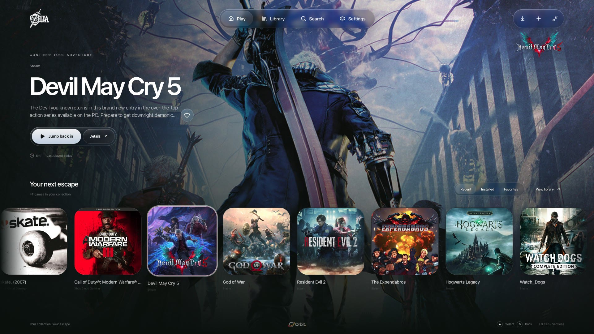
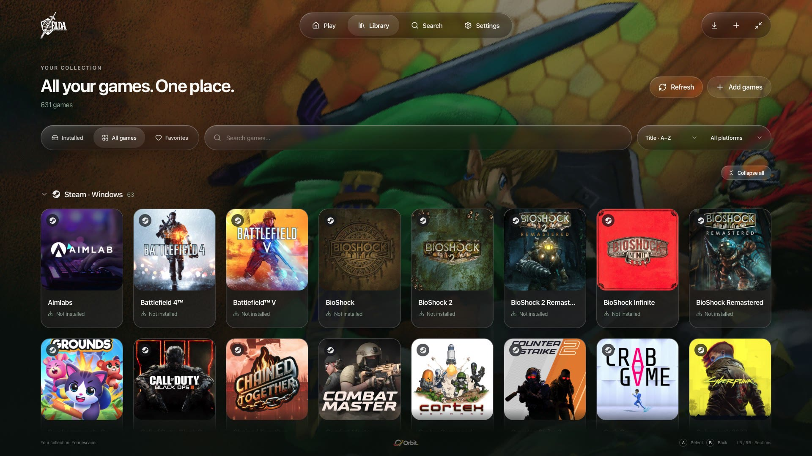
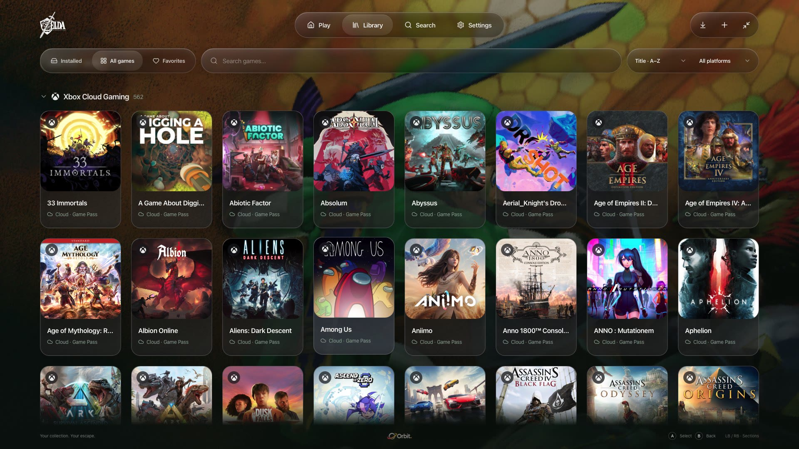
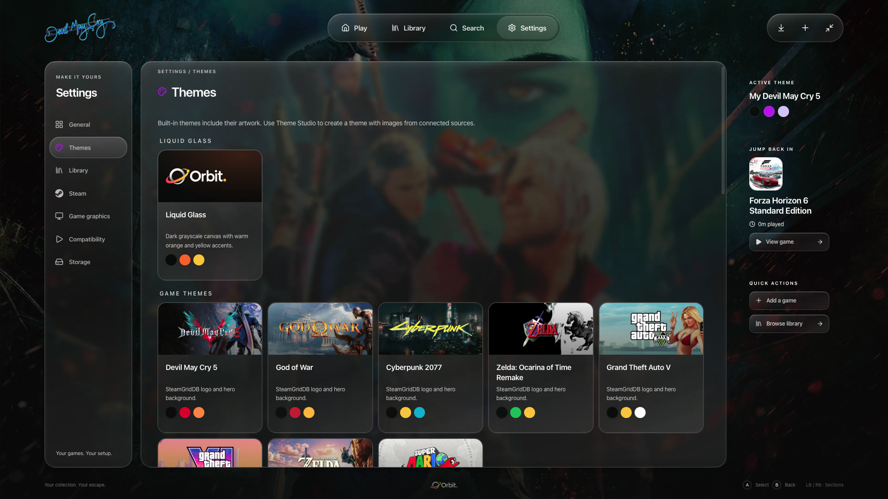
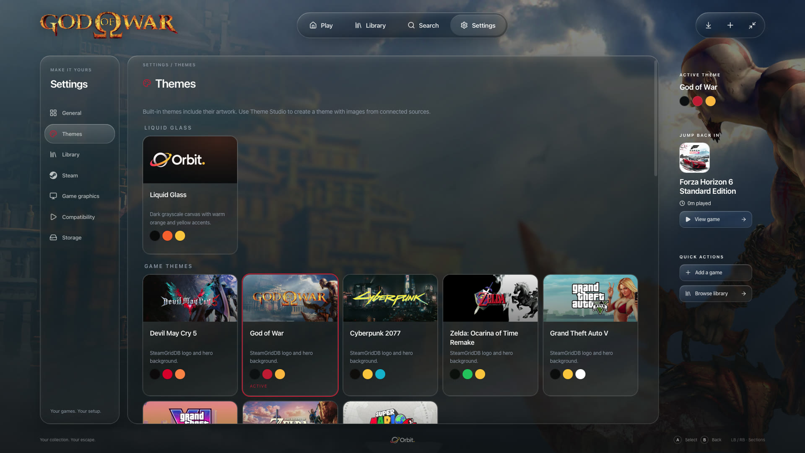
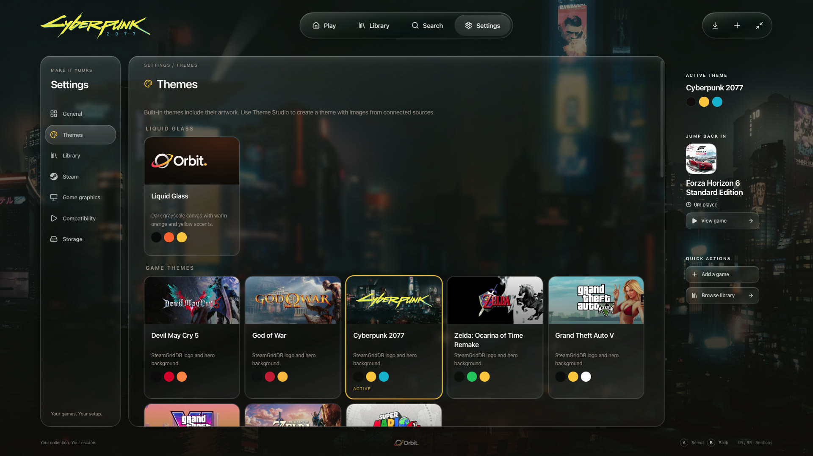

<p align="center">
  
</p>

<h1 align="center">Every game. One orbit.</h1>

<p align="center">
  <strong>The controller-first game launcher for your Mac.</strong><br />
  Steam, Windows games through Orbit Wine &amp; Apple’s Game Porting Toolkit, Xbox Cloud Gaming, and your Mac apps — in one local, open-source library.
</p>

<p align="center">
  <a href="https://github.com/LFSCamargo/orbit/releases/latest"><strong>Download latest release (macOS Apple Silicon)</strong></a> ·
  <a href="CHANGELOG.md">Changelog</a> ·
  <a href="RUNNING.md">Build from source</a> ·
  <a href="docs/THEMES.md">Themes</a>
</p>

<p align="center">
  Free and open source · Apple Silicon · macOS 12+ · Local by default · No Orbit account
</p>



---

## Why Orbit

Orbit is not another store, emulator, or cloud account. It is a calm, couch-ready control center for the games you already own on your Mac — built with **Tauri 2**, **Rust**, **React 19**, **TypeScript**, and **SQLite**. All filesystem, runtime, and process work lives in Rust; your library, artwork, and settings stay on your Mac.

|               | Orbit                 | Typical launcher        |
| ------------- | --------------------- | ----------------------- |
| **Price**     | Free, forever         | Free tier, paid extras  |
| **Code**      | Open source on GitHub | Closed                  |
| **Account**   | None needed           | Required to start       |
| **Your data** | Stays on your Mac     | Synced to their cloud   |
| **Tracking**  | None, no ads          | Common                  |
| **Built for** | The Mac and the couch | A desktop or phone port |

---

## Four worlds. One launcher.

- **Steam (Mac & Windows)** — Sign in with your Steam account, browse your owned library, download Windows depots directly into Orbit with a live download queue, or add existing Steam library folders.
- **Windows games via Orbit Wine** — Run Windows Steam titles, installers, and `.exe` folders in isolated per-game containers with **Orbit Wine**, **D3DMetal** (Apple Game Porting Toolkit), **DXMT**, **DXVK**, **MoltenVK**, **MSync**, **AVX**, **MetalFX**, and **macOS Game Mode**.
- **Xbox Cloud Gaming** — Link a Microsoft account with cloud gaming access via device code, browse the catalog, and stream games inside Orbit’s own fullscreen player with controller input, rumble, and pause/resume through the Home menu.
- **Mac apps & local libraries** — Native macOS games and apps, Astris Switch ROMs (`.nsp` / `.xci`), and manual file/folder imports — all unified in one searchable library.

| Steam & Windows library                                                                 | Xbox Cloud Gaming                                                                                              |
| --------------------------------------------------------------------------------------- | -------------------------------------------------------------------------------------------------------------- |
|  |  |

---

## Highlights

- **Unified, fast library** — Installed, All games, Favorites, and Search share one grid with source badges, collapsible sections, accent-insensitive search, playtime tracking, and measured install sizes.
- **Tuned for Apple Silicon** — Recommended compatibility defaults out of the box, automatic startup crash prevention, macOS Game Mode for Orbit Wine sessions, and background stand-down while you play (pausing UI/network churn and moving Steam’s `steamwebhelper` to macOS background priority).
- **Controller-first from the couch** — Predictable `O(1)` spatial focus, Bluetooth and USB controller passthrough straight to your games, right-stick pane scrolling, Guide/Home menu overlay, and idle-free gamepad polling.
- **Liquid Glass themes & Studio** — Built-in color themes, 13 bundled offline game themes (Devil May Cry 5, God of War, Cyberpunk 2077, Zelda: Ocarina of Time & Breath of the Wild, Grand Theft Auto V & VI, Super Mario, and more), plus a built-in **Theme Studio** to customize logos, wallpapers, taglines, and accents.
- **Artwork & metadata** — Automatic or on-demand enrichment via TheGamesDB, SteamGridDB, RAWG, Wikimedia, and the Steam Store, with a visual artwork picker and local cache.

### Themes

| Devil May Cry 5                                                                      | God of War                                                                 | Cyberpunk 2077                                                                     |
| ------------------------------------------------------------------------------------ | -------------------------------------------------------------------------- | ---------------------------------------------------------------------------------- |
|  |  |  |

Custom themes are stored as plain JSON in `~/Library/Application Support/Orbit/themes/*.json`. See [docs/THEMES.md](docs/THEMES.md) and [docs/examples/arcade-neon.json](docs/examples/arcade-neon.json).

---

## Install

**Requirements:** macOS 12 Monterey or later, Apple Silicon (M1 or later). Windows games also require Rosetta 2, which macOS prompts to install on first launch.

1. Download **`Orbit-<version>-aarch64.dmg`** from [GitHub Releases](https://github.com/LFSCamargo/orbit/releases/latest).
2. Open the disk image and drag **Orbit** into **Applications**.
3. Launch Orbit from Applications. Existing library data, settings, Steam sign-in, and custom themes are preserved in `~/Library/Application Support/Orbit/`.

Verify downloads with the release’s `SHA256SUMS.txt`.

---

## Controller & keyboard mapping

Every screen works with a controller (Xbox, PlayStation, or Nintendo layout), keyboard, or mouse.

| Controller         | Keyboard   | Action          |
| ------------------ | ---------- | --------------- |
| D-pad / left stick | Arrow keys | Navigate        |
| Right stick        | Scroll     | Scroll pane     |
| A / Cross          | Enter      | Select          |
| B / Circle         | Escape     | Back            |
| X / Square         | `F`        | Edit properties |
| Y / Triangle       | `C`        | Add game        |
| L1 / R1            | `[` / `]`  | Switch sections |
| Menu / Options     | `M`        | Settings        |
| Guide / Home       | —          | Home menu       |

---

## Platform & Tech stack

| Target                | Status       |
| --------------------- | ------------ |
| macOS (Apple Silicon) | Primary      |
| macOS (Intel)         | Best-effort  |
| Linux / Windows       | Not targeted |

| Layer    | Stack                                                            |
| -------- | ---------------------------------------------------------------- |
| Shell    | Tauri 2 + Rust                                                   |
| Frontend | React 19, TypeScript, Vite, Tailwind CSS                         |
| State    | Zustand, TanStack Query                                          |
| Motion   | Framer Motion, Three.js (`@react-three/fiber` / `drei`)          |
| Database | SQLite (`rusqlite`)                                              |
| Input    | Browser Gamepad API, native `gilrs` Home listener, spatial focus |
| Testing  | Cargo tests, Vitest, Playwright E2E, Knip                        |

---

## Monorepo & Quick start

Orbit is an **Nx monorepo** on Yarn workspaces with two apps:

| App                            | What it is                                                   |
| ------------------------------ | ------------------------------------------------------------ |
| [`apps/desktop`](apps/desktop) | The Orbit macOS desktop launcher (Tauri 2 + React + Rust)    |
| [`apps/landing`](apps/landing) | Next.js marketing site, install guide, and release downloads |

```bash
yarn install
yarn tauri:dev        # full desktop app (Rust + React)
yarn dev              # desktop frontend only (mock Tauri API)
yarn dev:landing      # landing site on http://localhost:3000
```

### Quality checks

```bash
yarn format:check     # Prettier
yarn knip             # unused files, exports, and dependencies
yarn typecheck        # TypeScript (desktop + landing)
yarn test:unit        # Vitest (desktop + landing)
yarn test:rust        # Cargo workspace tests
yarn test:e2e         # Playwright E2E specs
yarn build            # production build (desktop + landing)
```

### Building a release

Package macOS release artifacts (`.dmg`, `.app.tar.gz`, `SHA256SUMS.txt`) into `release/<version>/`:

```bash
yarn release:macos                     # native arch (Apple Silicon or Intel)
yarn release:macos -- --arch universal
yarn release:macos -- --arch aarch64 --skip-tests
```

Scaffold a version bump, `CHANGELOG.md` entry, and `.github/release-notes/<version>.md`:

```bash
yarn monopipeline release minor --summary "Release summary"
```

Full setup, app data paths, and troubleshooting: **[RUNNING.md](RUNNING.md)**.

---

## Repository layout

```text
apps/desktop/src/             React frontend (modules, components, controllers, themes)
apps/desktop/src-tauri/src/   Rust backend (commands, database, importers, launching, runtimes, services)
apps/desktop/e2e/             Playwright specs
apps/landing/src/             Next.js landing site (home, install, download, docs)
scripts/                      Release, version sync, theme bundling, cleanup, skill sync
docs/                         Architecture, runtime, Steam, cloud, UI, and theme docs
```

## Documentation

| Doc                                            | Contents                                                       |
| ---------------------------------------------- | -------------------------------------------------------------- |
| [RUNNING.md](RUNNING.md)                       | Local setup, dev modes, tests, app data paths, troubleshooting |
| [CONTRIBUTING.md](CONTRIBUTING.md)             | How to contribute, quality gates, PR expectations              |
| [CHANGELOG.md](CHANGELOG.md)                   | Version history and release notes                              |
| [docs/DESIGN_DOC.mdc](docs/DESIGN_DOC.mdc)     | Product scope, screens, Tauri commands, data model             |
| [docs/PROJECT.mdc](docs/PROJECT.mdc)           | Repo layout, scripts, tooling                                  |
| [docs/TAURI.mdc](docs/TAURI.mdc)               | Rust backend, importers, launch flow                           |
| [docs/FRONTEND.mdc](docs/FRONTEND.mdc)         | React screens, controller system, performance rules            |
| [docs/UI.mdc](docs/UI.mdc)                     | Design tokens, Liquid Glass components, theme system           |
| [docs/THEMES.md](docs/THEMES.md)               | Authoring custom JSON themes                                   |
| [docs/CONTAINERS.md](docs/CONTAINERS.md)       | Per-game Orbit Wine containers and graphics backends           |
| [docs/RUNTIMES.md](docs/RUNTIMES.md)           | Runtime catalog, GPTK, DXMT, DXVK, MoltenVK                    |
| [docs/STEAM_WINDOWS.md](docs/STEAM_WINDOWS.md) | Windows Steam sign-in, downloads, and launching on macOS       |
| [docs/XBOX_CLOUD.md](docs/XBOX_CLOUD.md)       | Xbox Cloud Gaming catalog, auth, and built-in player           |
| [docs/ARTWORK.md](docs/ARTWORK.md)             | Artwork enrichment providers and fallback caching              |
| [docs/LANDING.md](docs/LANDING.md)             | Landing site routes, release parsing, and deployment           |

---

## Contributing

Contributions are welcome. Read [CONTRIBUTING.md](CONTRIBUTING.md) for workflow, quality gates, and scope guidelines.

## Out of scope

ROM downloads or decryption, key management, emulator distribution, automatic online artwork scraping without user-configured keys, an Orbit account, cloud Steam login, a reimplemented Steam protocol, Steam DRM bypass, cloud sync, and social features.
