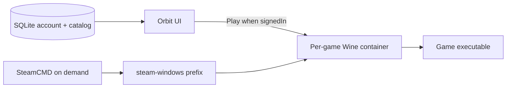
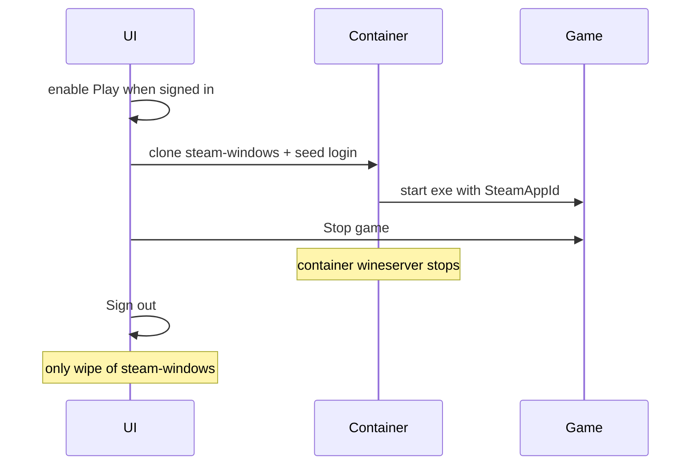

# Windows Steam on macOS

Status: first slice. macOS Apple Silicon stays the first target. Epic, GOG, and streaming stay deferred.

Sign-in is one button in **Settings → Steam**. It opens Valve's Windows Steam client in the `steam-windows` prefix. After Steam has written its refresh token, Orbit stores that login and closes Wine. Only the `steam-windows` prefix is read; game containers hold tokens Orbit wrote. A newer sign-in there replaces the stored one, and Play captures it too if Settings has not yet. A web cookie is not required. A website or QR sign-in is not a container session: only a token whose JWT audience includes `client` is stored or handed to a container, because Steam refuses a `web` token there as "Invalid Password". Orbit never collects the password. Installed games are read from library folders, per-game containers, and older `steam-windows/games/` copies. `steam-windows` is a seed, never a wipe. See [CONTAINERS.md](CONTAINERS.md). The Library lists games that are not installed and games already on disk. Open a game, download it, then play it with the compatibility layer. SteamCMD runs only during a download and is not left resident. Library screens read the SQLite snapshot.

## What already ships

Installed Mac Steam libraries are still scanned from local VDF files. Owned games with a macOS build download through Steam for Mac from the Orbit queue (see **Download**). Play still uses `steam://rungameid/{appId}`. `install_steam_game` still opens the Mac Steam app, and only when the store lists a Mac build. Additional Steam library folders may be added in Settings. A manually imported Windows `.exe` still launches through the Wine or GPTK runtime in [RUNTIMES.md](RUNTIMES.md).

## Integration layer

Orbit remains the library UI. A Rust silent-client service owns the resident `steam.exe`, extra-library links, and `steam-client` events. SteamCMD runs only for a download. SQLite holds the account name and catalog; it is not the logon proof. The frontend only invokes typed commands and never sees a password, guard code, or session file.

### In-container Steam agent (opt-in)

A Steamworks title refuses to start without a logged-on Steam client it can reach through its own `steam_api64.dll`. Instead of a full `steam.exe` (CEF, `steamwebhelper`, a bootstrap updater) per container, Orbit ships a lightweight Rust client, `orbit-steam-agent` (`helpers/steam-agent`, built for `x86_64-pc-windows-gnu`, embedded from `assets/orbit-steam-agent.exe`). Orbit writes it into the container as `steam.exe`, hands it the saved login through a 0600 `…/Steam/.orbit-agent/session.json` (read once, then deleted), and starts it under Wine. The agent DPAPI-wraps the refresh token into the account's `local.vdf` ConnectCache (key = `crc32(account)` + `1`, matching Valve), writes `loginusers.vdf`/`config.vdf`, points `HKCU\…\Valve\Steam\ActiveProcess` at the container's `steamclient64.dll`, then `LoadLibrary`s that DLL and logs on through its flat exports (`Steam_CreateSteamPipe`, `Steam_CreateGlobalUser`, `Steam_LogOn`, `Steam_BLoggedOn`). It stays the IPC master, with no window, until Orbit drops `.orbit-agent/stop`. The token is never logged. Pure VDF/ConnectCache formatting lives in `crates/orbit-steam` (`connect_cache`) and is host-tested.

Play uses this agent when Steam's own window has saved a refresh token (`native-session.json` with `client_login`). Older clients write it as `RefreshToken` in `config.vdf`. Current clients keep it only in the user's `local.vdf` ConnectCache, DPAPI-wrapped, so Orbit runs the agent once in unwrap mode (`ORBIT_AGENT_UNWRAP` / `ORBIT_AGENT_ACCOUNT` / `ORBIT_AGENT_OUT`) beside Valve's client in `steam-windows`. It calls `CryptUnprotectData` with the account name as entropy and returns the token through a 0600 `.orbit-agent/token` file that Orbit reads and deletes. Orbit downloads Valve's client binaries on demand from `client-update.steamstatic.com` (the same way it downloads Wine and GPTK — they are not redistributed), caches them under `runtimes/steam-client/<version>/Steam`, and links them into the container beside the agent. The agent cannot host steamclient yet: `steamclient64.dll` only connects to a running IPC master, so `Steam_CreateSteamPipe` returns 0 and the attempt cost about a minute per Play. Play therefore starts Valve's silent `steam.exe` with the saved token directly, and tries the agent first only with `ORBIT_STEAM_AGENT=1`. The agent binary is still used to unwrap the Settings sign-in. If that session is expired or missing, Play stops and asks for **Settings → Steam**. Known delay: Valve's login UI waits 20 s in `WaitingForNetwork` under Wine before logging on (`-noipv6` does not change it).

Ready vs Play: the UI enables Play when `signedIn` and the Windows install is available. Rust waits until that game's container client is logged on, then starts the game. `steam-windows` is not left running.

- **Sign-in** launches official `steam.exe` once in Orbit's `steam-windows` prefix, with Steam's browser forced onto the CPU so the QR code is visible under Wine. Exclusive macOS fullscreen is dropped for that dialog so the Steam window can sit on the same space as Orbit, then restored when sign-in ends. Orbit places the 840×520 window on the sign-in dialog and polls until Steam writes `config/loginusers.vdf`. After a successful login Orbit hides that window and stops `steam.exe`. The saved `loginusers.vdf` is the seed for each game container. Sign-out is the only wipe. The account name is stored in SQLite. The password is never stored. The frontend receives signed-in state, the account name, and an error state. A library snapshot without `loginusers.vdf` still shows Sign in.
- **Library** refreshes on every boot (via `useSteamStartupSync` calling `refresh_steam_windows_library` once signed in, independent of `scanOnStartup`) as well as on manual Refresh. Local discovery (`services/steam_local_catalog.rs`) reads `localconfig.vdf` plus `appcache/packageinfo.vdf` (skipping base package `0`) joined with `appcache/appinfo.vdf` (keeping only playable `game`, `demo`, `mod`, `beta` titles with their real names) across `steam-windows`, Orbit containers, and the local Mac Steam install when its `loginusers.vdf` matches the signed-in account. Fresh (`< 36 h`) `steamLoginSecure` web cookies still query `GetOwnedGames` with `include_appinfo` without spawning Wine for expired cookies. When online and idle with a saved client session, a single cancellable background job (`services/steam_background_sync.rs`, state owned by `AppState`) runs Valve's official `steam.exe -silent -no-browser` inside a reusable APFS-cloned container (`runtimes/containers/steam-sync/prefix`) so games purchased on mobile or web sync from Steam's CM servers even without Mac Steam, then shuts down immediately and emits `steam-library-updated`; Play, downloads, sign-in, sign-out, and app exit cancel it at once and `steam-windows` is never modified. Square SteamGridDB grids (1024×1024 / 512×512) fill the Steam tiles when a local key is saved; Steam CDN art is the fallback. Steam's `controller_support` (`full`, `partial`, else `none`) is stored per title from the same appdetails call; a title never asked counts as needing metadata. Missing titles and longer store descriptions come from public store appdetails (`about_the_game`, HTML stripped) for every stale or incomplete title, installed and favorites first, batches of four, with a 7-day freshness window. Each app's Steam type comes from one batched `IStoreBrowseService/GetItems` call on the Web API host (it stays reachable when the store's per-app `appdetails` endpoint rate-limits an address). Only `game`, `demo`, `mod` and `beta` titles appear in the Library, Home and owned-game lists, so software such as Driver Booster, tools, soundtracks, videos and DLC stay out. Apps the store has no item for (Steam's client, SDKs, Screenshots, delisted games) are shown only with play history or a local install. Unclassified entries stay visible until the lookup succeeds; a failed lookup is retried on the next hydrate. Extra-library installs that are not in GetOwnedGames still get a catalog row so hydrate can replace importer stubs. A loading overlay stays up while that catalog hydrates. The Library search box covers the full owned catalog (capped at 2,000). Installed / All games lists owned titles that are on disk (including additional library folders) versus owned titles that are not. The access token is used once and is never stored. The Mac-native scan and `steam://` launch stay as they are. Additional Steam library folders count as installed and can play through the same Wine path.
- **Download** sets the client platform to Windows, installs with SteamCMD into that title's container (`runtimes/containers/games/steam-{appId}/install/`), and reports progress through the existing `steam:<appId>` tracker in `apps/desktop/src/lib/downloadProgress.ts`. One download at a time. Older copies under `steam-windows/games/` still count as installed. The user follows that work from the shell, not from a resident Steam window.
- **Play** clones a slim per-Wine base container (`runtimes/containers/bases/`), leaf-symlinks Valve's Steam client files from `steam-windows` (0 extra binary disk usage), writes `steam.cfg` (`BootStrapperInhibitAll = Enable`) so a later Steam start does not open the updater, and links extra library folders into that container's `steamapps`. Play then signs that container's Valve `steam.exe` on silently with the saved refresh token while streaming Step 7 login sub-stages (`Injecting the saved Steam login` → `Starting Steam for this game` → `Connecting to Steam` → `Signing in to Steam` → `Preparing Steam for launch`), and starts the game with `SteamAppId` / `SteamGameId` only after that client logs `System startup time` (Logged On comes first, and a game started in between cannot attach, asks Steam to relaunch it, and exits 53). It does not open a second login window. If Valve refuses the saved token (`Access Denied`, `Invalid Password`, `Expired`, `Revoked`), Orbit clears the rejected session first across `native-session.json`, `steam-windows`, the container, and `steam-sync` (never swallowing cleanup errors) and then force-stops the container without waiting 8 s on `steam.exe -shutdown`, so UI status flips from Authorized immediately and asks for **Settings → Steam**. Home and details enable Play when `signedIn`. GPTK (D3DMetal) is the Automatic graphics choice when installed, then DXMT, then DXVK+MoltenVK. Explicit DXMT or DXVK selections still win. SteamCMD is not left running. Stopping the game stops a container wineserver that is not the already signed-in client. Orbit uses the official Steam client files only as a symlinked runtime and auth seed.
- **Hidden client**: the container's Steam client never shows itself while it signs a game in or syncs the library. Wine's Mac driver makes any Wine process with a window a regular app (Dock icon, app menu, Cmd-Tab entry) and asks the other Wine apps, the game included, to yield focus to it, and `explorer.exe` turns Steam's tray icon into a menu bar status item (`ShowSystray` and `NoTrayItemsDisplay` do not stop that). Orbit therefore starts the container's Steam commands (`steam_windows::hidden_steam_command`: the silent client, `-shutdown`, its `reg` calls, the agent, and the background sync) with `DYLD_INSERT_LIBRARIES` pointing at `OrbitHiddenClient.dylib` (`native/hidden_client.m`, built universal x86_64/arm64 and ad-hoc signed by `build.rs`, embedded and installed content-addressed under `runtimes/hidden-client/` by `runtimes/hidden_client.rs`). Wine passes the variable on to every process Steam starts. In processes Wine names `steam.exe`, `steamwebhelper.exe`, `steamservice.exe`, `steamerrorreporter*.exe`, `steamsysinfo.exe`, `gameoverlayui*.exe` or `orbit-steam-agent.exe`, the library turns Wine's `transformProcessToForeground:` and `tryToActivateIgnoringOtherApps:` into no-ops and keeps the activation policy at most Accessory, so Steam never appears in the Dock, the menu bar or Cmd-Tab and never takes focus from the game. Status items stay hidden in every process that loads it. The game and the Settings sign-in window are started without it.
- **Game process**: games start through Orbit's own executable as a trampoline (`--orbit-exec-detached`), which replaces itself (same pid) with the Wine command in a new session and disclaims macOS responsibility. Orbit runs with the hardened runtime, which strips `DYLD_*` variables from its own environment, so the trampoline carries them under an `ORBIT_DETACHED_` prefix and restores only `DYLD_*` names for the exec (including `DYLD_INSERT_LIBRARIES`). The game is then its own responsible process, so macOS Game Mode follows the game instead of being credited to Orbit and paused when the game takes the foreground. Once the game's Dock-visible window appears (newest regular app whose Windows `argv[0]` is not Steam or a Wine service), Orbit yields activation to the game, activates it and only then hides itself as an app (macOS 14+ activation is cooperative: a request is honoured only when the active app yields, so hiding first left the desktop in front); Orbit stays in front until the game exists and returns when the session ends. Return to game / Resume does the same hand-off: hiding only the window of a fullscreen app leaves its Space behind as a black screen in front of the game, and macOS grants Game Mode only to the frontmost fullscreen game. macOS (`gamepolicyd`) classifies a game by the process's LaunchServices bundle record and its category, so a bare Wine loader is never a game and Game Mode boosted Orbit instead. Wine launches therefore run through `Orbit Game.app` (`com.orbit.launcher.game`, `public.app-category.games`, `LSUIElement`), built under `runtimes/game-bundles/<hash>`: the loader is copied to `Contents/MacOS/wine`, `ntdll.so` is copied into a mirrored `lib/wine/<arch>-unix` (found through `WINE_NTDLL_SONAME`), and that directory's `wine` links back to `Contents/MacOS/wine`, so every child Wine process, the game included, resolves to the bundle. The bundle is ad-hoc signed (the copied loader's own signature binds a different Info.plist) and registered with LaunchServices; it is rebuilt when the loader or `ntdll.so` changes. Loaders without `WINE_NTDLL_SONAME` (Orbit's own Wine builds) run unbundled. While a game runs Orbit's background loops stand down: the controller listener only watches Home at 20 Hz and sends no stick-scroll events, and Steam status polling (a system-wide `ps`) pauses.

Sign-in is Steam's own client window, not a separate HTTP QR. Cancel and Sign out stop that window. SteamCMD exists only during a download. Library screens read SQLite. Catalog hydrate fetches store copy and SteamGridDB square grids for every stale title, four requests in flight. The sidebar lists matching owned games (80 until the filter box is used). Status is one settings read. A library refresh reads one local Steam file, capped at 8 MiB, or returns the saved snapshot when that file is absent.

Rejected for this roadmap: leaving the full Steam GUI running after login, storing the Steam password, and copying Heroic or Legendary source. Epic, GOG, and streaming stay deferred.

## Shell

The macOS shell header (`MacosShell.tsx`) keeps Add games in the right-hand utilities group. **Downloads** sits beside that button and opens a right-hand Liquid Glass sidebar through `DrawerProvider`. The sidebar has three states. Before Steam is authorized it shows the Steam orbit illustration, **Connect Steam** (Steam's own sign-in window), and Downloads / Queue / Network as unavailable. Signed in with nothing running, it shows empty Downloads and Queue cards and Network at 0 B/s. With transfers, each download row shows cover art, title, speed, `x GB / y GB`, a bar and percent, with Pause and Cancel; the queue lists waiting titles in order with Run next and Remove; Each download row also shows its step (`3/7 · Starting download`), elapsed time and time left, refreshed every second. Network shows the Mac's real download and upload rates and whether it is online (`services/network_monitor.rs` reads the interface byte counters once a second, skipping loopback, VPN tunnels and AirDrop links, and emits `network-stats`, except while a game or cloud stream plays, when only a change of online state is sent), with a sparkline of the last 40 download samples. It is not a packet capture. Sign out lives in **Settings → Steam**. The sidebar card has no password field. Steam's hosted window can show one. Controller focus reaches the toolbar control and the sidebar, and the sidebar closes cleanly.

## Performance

Each phase is profiled on Apple Silicon before it is done. Measure Orbit and the game container for CPU and resident memory while idle, during a library refresh, during a download, and during play. After sign-in, `steam-windows` keeps the saved login; Play clones a per-game container instead of keeping silent `steam.exe` resident. Progress events stay throttled the way compatibility downloads already are. Library screens keep reading SQLite. Record the sample with the phase notes.

## Phases

### 1. Authentication layer

Implemented. Sign-in opens Valve's Windows Steam login window (QR and account) in the managed Wine prefix when no account is saved. Orbit does not collect the password. The account name is stored in SQLite after Steam writes the local login. Sign-in never deletes a prefix that already has `steam.exe` or `loginusers.vdf`; Install Steam for Windows is a no-op when Steam's browser helper is present. Otherwise it runs Valve's setup if needed, starts `steam.exe` so the client can finish downloading, and waits until `steamwebhelper.exe` exists under `bin/cef/cef.win64`, `cef.win7x64`, or `cef.win7` (Wine often ships the Win7 helper). Progress and errors use the `steam:setup` tracker, including package-download bytes while the client update is still running. A bootstrapper-only `steam.exe` is not treated as ready to sign in. Sign-out is the only action that deletes `steam-windows` and the saved snapshot. If Orbit opened Steam, it hides the login window after `loginusers.vdf` is written and stops `steam.exe`. Sign-out is the only action that deletes `steam-windows`.

### 2. Owned library

Implemented. Depends on phase 1. Sign-in stores the owned catalog (app ID + Steam title + playtime) from `GetOwnedGames` when the web session is ready, and always merges local `apptickets` IDs, capped at 2,000, without wiping saved titles or playtime. An empty GetOwnedGames response does not erase local tickets. Local `localconfig.vdf` Playtime fills gaps when the Mac or Wine Steam client has minutes and the snapshot does not. Ticket values are not kept. Library tiles use square SteamGridDB grids when a local key is saved. Details show the longer store description. A loading overlay covers the Steam grid while the catalog hydrates. Search covers the full owned list. The sidebar shows 80 titles until the filter box is used. Library Installed shows disk copies (Orbit downloads and additional library folders); All games includes owned titles that are not installed.

### 3. Download

Implemented. Depends on phase 2. One Windows depot install runs at a time into that title's container (`runtimes/containers/games/steam-{appId}/install/`). The first download fetches Valve's official SteamCMD archive into `steam-windows`. Progress uses the `steam:<appId>` task and carries the game's title.

**Native macOS builds first.** Only Steam downloads games. When Steam ships a macOS build of a title (a non-DLC depot with `oslist` `macos` in `appcache/appinfo.vdf`, or the store's `platforms.mac` when appinfo has no answer), the catalog marks it `macBuild` and the queue downloads that build with **Steam for Mac** instead of the Windows build (`services/steam_mac_download.rs`). Steam for Mac picks the depots for this Mac, so an Apple Silicon Mac gets the Apple Silicon build (Cyberpunk 2077, for example). The strategy matches the container path: with Steam closed, Orbit writes the same "install this app" appmanifest into Steam for Mac's library (`~/Library/Application Support/Steam/steamapps`) and starts Steam fully hidden; with a Steam the person opened already running it opens `steam://install/<appId>` and the person confirms there (10-minute start window). Orbit's own hidden client is restarted instead, so the new manifest is read.

**One silent entry per client.** Every Steam Orbit starts goes through one function per client. Windows Steam (container clients, setup installer, updater, `-shutdown`, background sync) uses `steam_windows::hidden_steam_command`; the sign-in window is the only visible launch, because it shows the QR code. Steam for Mac (downloads and Play via `steam://rungameid`) uses `services/steam_mac_client.rs`. `-silent` alone only hides Steam's window: Steam for Mac's Info.plist makes it a regular app with a Dock icon, Cmd-Tab entry and menu bar. So Orbit starts the client executable `Steam.AppBundle/Steam/Contents/MacOS/steam_osx -silent` directly, detached like a game, with `runtimes::hidden_client` (`native/hidden_client.m`) in `DYLD_INSERT_LIBRARIES`. The `Steam.App` launcher cannot be used because it is hardened and drops the library; `steam_osx` is not hardened. The library switches `steam_osx` to an accessory app when AppKit finishes launching, blocks activation and `TransformProcessType` to the foreground, and hides status items. It then clears `DYLD_INSERT_LIBRARIES`, so games Steam starts never load it; it stays set until then because Steam re-launches itself during start-up. `lsappinfo` reports the hidden client as `UIElement` and a Steam the person opened as `Foreground` (`steam_mac_client::running_hidden`). Handoffs meant to show Steam (Open Steam library, the Mac store install dialog) use `open_visible`, which restarts Orbit's hidden client the normal way first. Stopping uses `steam_osx -shutdown`; Steam ignores SIGTERM. Orbit's hidden client runs only while a macOS game plays through `steam://rungameid` or a macOS download runs (`steam_mac_client::release_if_unused`): it is quit when the download queue drains, when a macOS game's session ends, before a Windows game launches, and on Orbit start-up. A resident Steam for Mac claims USB controllers such as 2.4 GHz XInput dongles, so a Windows game in a container would see no controller. A Steam the person opened is never closed. Before Steam for Mac's first run there is no `steam_osx` yet, so Steam is opened the usual way to set itself up. Progress reuses the container watcher (`steam_client_download::watch`) on Steam for Mac's manifest and `logs/content_log.txt`. Pause, cancel and offline quit Steam (`steam_osx -shutdown`) only when Orbit started it; Steam resumes the partial download next time. The finished game is saved as a macOS Steam installation (`steam_mac_download::register`) and plays through `steam://rungameid`. Native downloads need Steam for Mac installed and signed in, not Orbit's Windows sign-in, and skip the folder picker (Steam for Mac keeps the files in its own library). A running Windows game does not block them. Without Steam for Mac, the title falls back to the Windows build below. Uninstalled titles with a macOS build are listed as macOS, and **Space needed** is the macOS depots' size (`mac_required_bytes`: macOS plus shared depots, 32-bit-only depots left out); other titles show the Windows size.

**Queue.** `services/download_queue.rs` is a FIFO: Install adds a title (`enqueue_steam_download`) and returns at once; one worker runs SteamCMD per title in order. The queue is saved in settings (`download-queue-v1`) and comes back paused after a restart, so nothing starts on its own. Pause stops SteamCMD and puts the title back at the front, paused; SteamCMD resumes from its partial files. Cancel stops it and drops it. Neither is reported as a failure (the event carries `stopped: true`). `start_queued_download_now` runs a waiting title next and pauses the current one. Queue changes emit `download-queue-changed`.

**Install location.** Install opens a picker (`InstallLocationDialog`) and **Settings → Library** exposes **Steam download locations** (`SteamDownloadLocations`): This Mac (the game container's own Steam library) or a folder the person added, often on an external drive or a new folder path on a connected SSD (created automatically if its parent or mounted volume exists, while refusing unmounted `/Volumes/<drive>` targets), with each drive's free space; the last choice is preselected while connected. Games in a picked folder live in its `Orbit Games` subfolder (`Orbit Games/steamapps/common` with `libraryfolder.vdf` prepared immediately), so a Mac Steam library picked by mistake is never mixed with Windows manifests. `services/install_locations.rs` keeps the folders and each game's choice (`steam-install-locations-v1`). Before the client starts, the download maps that library to a Wine drive (S:–Y:) in the game's container and lists it in Steam's `libraryfolders.vdf`; the appmanifest goes in the library's `steamapps`, so Steam checks free space and writes on that drive. The content log stays with the container's client. The container's library repair keeps the main library and these drives once each (paths compared without doubled or trailing backslashes, which had let one drive repeat 33 times) and drops other drive libraries. Install lookup, sizes and uninstall follow the game's library (`steam_client_download::game_steamapps`); uninstall frees the location, and library/play lookups also check connected install-location `steamapps/common` folders. A download whose drive is not connected fails with a message instead of writing to This Mac. Orbit writes Steam's `libraryfolder.vdf` identity file (library root and `steamapps`) into a picked library and sets the container's library entry to the same `contentid` before the client starts; a missing file or a different id makes Steam log "Install folder S: not mounted" and never start. The folder's id is kept once written, so every container sharing the library agrees, and drops an unfinished copy of the game from the container's own library when it moves (a finished install there is never touched). An existing appmanifest is resumed, not replaced: Orbit clears Steam's Update Paused bit (`0x200`) and the last `UpdateResult` (for example 12, not enough disk space), since Steam never restarts a paused update on its own.

**Game fixes.** `services/game_fixes.rs` keeps Windows games from crashing at start. Known games are fixed before every launch, the first run in a new container included (`steam_play::start_title`): Capcom RE Engine titles crash in DirectX 12 under D3DMetal (Devil May Cry 5: a page fault reading 0x0 inside the game), so Orbit sets `TargetPlatform=DirectX11` in the game's own ini (`dmc5config.ini`, `re2_config.ini`, `re3_config.ini`, created if missing) and keeps Steam's overlay off for them. An unknown RE Engine game (`re_chunk_000.pak` in its folder) that exits non-zero within two minutes of starting (exit 53, Steam not ready, and signal kills `-1` excluded) records a DirectX 11 step in `game-crash-fallbacks-v1` and sets `TargetPlatform=DirectX11` in the inis it wrote on the next launch. Orbit never overrides the person's selected graphics layer; legacy step-2 (DXVK) entries in `game-crash-fallbacks-v1` are dropped on startup, and `runtimes/containers/graphics.rs` removes any stray non-builtin graphics DLLs from `system32` and `syswow64` when applying D3DMetal or DXMT. The session emits `game-crash-fallback` `{ gameId, message }` after `game-session-ended`, and the launch card shows what changed instead of only the exit code. Symlinks and files over 256 KB are skipped; failures are logged and never block a launch.

**Container sign-in.** The saved token is written into the `local.vdf` of the Windows user Wine runs Steam as, read from `APPDATA` in the prefix's `user.reg` (Orbit Wine runs as `crossover`; the clone also has a profile named after the Mac user). Picking the first user folder listed sent the token to the wrong profile in some containers, and Steam sat on `WaitingForCredentials` until "Steam did not sign in for this game".

**Offline.** The network monitor counts the Mac as offline when no link has a routable address, or, while downloads are queued, when a TCP connect to `api.steampowered.com:443` fails (probed every 10 s, every 3 s while offline; an idle Orbit makes no probe connections). A change must hold for three one-second samples. Going offline sets `waitingForNetwork`, stops the running title (outcome `Offline`, reported as `stopped`) and puts it back at the front unpaused; nothing starts while offline, and a download error raised while offline counts as the same stop. Coming back clears the flag and restarts the queue; Steam resumes from its partial download.

**Game fixes.** `services/game_fixes.rs` keeps Windows games from crashing at start. Known games are fixed before every launch, the first run in a new container included (`steam_play::start_title`): Capcom RE Engine titles crash in DirectX 12 under D3DMetal (Devil May Cry 5: a page fault reading 0x0 inside the game), so Orbit sets `TargetPlatform=DirectX11` in the game's own ini (`dmc5config.ini`, `re2_config.ini`, `re3_config.ini`, created if missing) and keeps Steam's overlay off for them. An unknown RE Engine game (`re_chunk_000.pak` in its folder) that exits non-zero within two minutes of starting (exit 53, Steam not ready, and signal kills `-1` excluded) records a DirectX 11 step in `game-crash-fallbacks-v1` and sets `TargetPlatform=DirectX11` in the inis it wrote on the next launch. Orbit never overrides the person's selected graphics layer; legacy step-2 (DXVK) entries in `game-crash-fallbacks-v1` are dropped on startup, and `runtimes/containers/graphics.rs` removes any stray non-builtin graphics DLLs from `system32` and `syswow64` when applying D3DMetal or DXMT. The session emits `game-crash-fallback` `{ gameId, message }` after `game-session-ended`, and the launch card shows what changed instead of only the exit code. Symlinks and files over 256 KB are skipped; failures are logged and never block a launch.

**Shader preload.** Orbit reads existing per-game D3DMetal caches first and then the Orbit Wine Metal cache, up to 2 GiB and 20,000 entries. For every container title the launch overlay shows the percentage of selected cache bytes read before the game process starts. Cancel stops the warmup and launch. Missing caches are skipped, and a title with none yet says the game compiles its shaders on its first start: Orbit cannot compile a game's pipelines, only load what earlier runs compiled. Ragnarök defaults to a 60 FPS D3DMetal cap and respects an explicit frame limit.

**Game patches.** `services/game_patches.rs` holds title-specific patches that `steam_play::start_title` applies before every launch, a fresh download's first run included. God of War Ragnarök (2322010) needs AVX2 and F16C, so it always gets `ROSETTA_ADVERTISE_AVX=1`, even with the global AVX switch off; no CPU-bypass executable is needed. Community `no_avx2_f16c` builds match one game version: over a newer install they start, then halt in the settings menu with "Unrecoverable Lua error". When such a build (PE section `.avx2fix`) replaced `GoWR.exe` and the original is kept as `GoWR.exe.orbit-original`, the original is copied back and the bypass is renamed `GoWR.exe.cpu-bypass`, never deleted. Symlinks are never followed; failures are logged and never block a launch.

**Container sign-in.** The saved token is written into the `local.vdf` of the Windows user Wine runs Steam as, read from `APPDATA` in the prefix's `user.reg` (Orbit Wine runs as `crossover`; the clone also has a profile named after the Mac user). Picking the first user folder listed sent the token to the wrong profile in some containers, and Steam sat on `WaitingForCredentials` until "Steam did not sign in for this game".

**Offline.** The network monitor counts the Mac as offline when no link has a routable address, or, while downloads are queued, when a TCP connect to `api.steampowered.com:443` fails (probed every 10 s, every 3 s while offline; an idle Orbit makes no probe connections). A change must hold for three one-second samples. Going offline sets `waitingForNetwork`, stops the running title (outcome `Offline`, reported as `stopped`) and puts it back at the front unpaused; nothing starts while offline, and a download error raised while offline counts as the same stop. Coming back clears the flag and restarts the queue; Steam resumes from its partial download.

**Progress phases.** Downloads run in the game container's signed-in Windows Steam client (`steam_client_download.rs`). Steam rewrites the appmanifest byte counters rarely, so progress comes from the client's `logs/content_log.txt` (`steam_content_log.rs`): each update step (reconfiguring, preallocating, downloading/staging, verifying, committing, fully installed), the real totals from `update started : download 0/X … stage 0/Y`, and a cancel or failure reason. `Suspended` (another app took priority) and connection reasons are not failures: Steam retries them, and Orbit's network monitor handles a real outage. Bytes come from what Steam has written into `steamapps/downloading/<appid>` (allocated blocks, scaled from staged to network bytes), measured once a second. If that folder already held more than half the staged size when the download began (Steam preallocated real blocks, or a large partial download resumed), bytes come instead from what the Mac has received since then, added to the `download X/Y` count Steam logged at the start, and capped at the total. The watcher emits progress at least once a second with a smoothed `bytesPerSecond`, so a stall reads as 0 B/s instead of the last speed. Downloads wait for the container's client to be logged on (`ClientWait::LoggedOn`), not for its full start-up as Play does, so "Signing in to Steam" ends as soon as Steam can start the download. Every step that has real numbers carries them (`step_event`): starting and allocating report the saved download position (a resumed download starts filled, not as a spinner), downloading also reports `stagedBytes` / `stageTotalBytes` (what is written to disk), and installing files reports bytes written of the install size. The frontend names seven steps for a game download (Preparing, Signing in to Steam, Starting download, Allocating disk space, Downloading, Verifying, Installing files) and shows them with the speed in the toast, the Downloads sidebar and the details status panel. Like Steam's downloads page, a sidebar row shows the step and amount ("Downloading · 36.4 GB of 107.6 GB"), an exact percentage with one decimal (rounded down, so it never reads 100% early), a bar that glides between the once-a-second updates with a soft sheen while active, the speed, time left ("25m left"), what is on disk, elapsed time, the download's own speed graph with its peak (last ~90 samples kept per task), and a seven-segment step track. Game start-up steps are mirrored into a toast as well.

**After a download.** The finished install is saved as a library installation right away (`register_download`), so the title shows as installed with its size before the first Play. Disk size comes from the `SizeOnDisk` in the appmanifest SteamCMD writes into the install folder; the downloaded byte total is kept in `steam-download-sizes-v1`.

**Uninstall.** `uninstall_steam_game(appId, deletePrefix)` deletes Orbit's own install folders (the container `install/` and the legacy `steam-windows/games/<appId>/`) and a Windows copy in a Steam library folder Orbit reads (added libraries, GameHub): `<library>/steamapps/common/<installdir>` as named by that app's appmanifest, plus the appmanifest itself. A library folder is chosen only when it holds a Windows `.exe`, so Mac Steam games are never touched, and libraries inside `steam-windows` are skipped. Each target is resolved and must sit inside its allowed root; a symlinked folder is unlinked, never followed. The game's `prefix/` (saves and settings) is deleted only when asked, and never when it holds `steam.exe` or `loginusers.vdf`. The shared `steam-windows` prefix is never touched. A running or queued download for the title is cancelled first. The owned title stays in the library as not installed.

### 4. Run

Implemented. Depends on phase 3 and the current Wine or GPTK launch path. Play saves a Windows library entry, clones an Orbit-owned container from `steam-windows`, seeds Steam login files, and starts the installed title's EXE with `SteamAppId`. Home and details enable Play when `signedIn`. The Play action opens a centered landscape banner with the game hero, logo, and a single caption for the current startup stage (`resolve` → `runtime` → `container` → `compatibility` → `steam` → `login` → `cloud` → `prefix` → `graphics` → `spawn` → `running`). If startup fails, the overlay keeps the error on that banner. Stopping the game stops the container wineserver. Sign-out is the only wipe of `steam-windows`. `wineserver -k` exiting 1 when the prefix is already idle is not a play failure; Orbit waits for `-w` to confirm shutdown.

## Non-goals

- An Orbit account, cloud Steam login, or cloud sync.
- Reimplementing the Steam protocol.
- Bypassing Steam DRM.
- Driving a third-party Steam agent or copying its packed client into Orbit's prefix.
- Redistributing SteamCMD. The machine uses Valve's official client.
- Changing Mac-native Steam scan, `steam://` launch, or the Mac-build install handoff.

Additional existing libraries can be configured in Settings → Library.
Accept a `steamapps/common` folder, its `steamapps` parent, or the library root.
Persist normalized folders in `additionalLibraryPaths` and merge manifest-based
Windows installs for owned-library installation status and Play. This preference
does not relocate downloads or move game files. Play also links those installs
into the managed Wine Steam `steamapps` folder and registers the library root as
a Wine drive (`S:` and up) in `libraryfolders.vdf`, so Steamworks sees extra-library
copies such as God of War as installed. Existing files in the prefix are not
replaced. A logged-on silent client is not restarted just to write
`libraryfolders.vdf`; that file is updated the next time Steam is stopped.

Executable discovery checks root files before nested assets within its
400-entry/four-level budget. This avoids missing GoW.exe behind large God of War
crash-data folders. Import scans run filesystem discovery off the async command
thread.

For Steam-linked Windows games, metadata/artwork matching uses the manifest AppID
rather than title search. On import/rescan, legacy automatic square icons are
replaced with verified 512×512 or 1024×1024 SteamGridDB grids resolved through that
AppID. A dedicated cache filename records this identity match. When unavailable,
the exact game's official Steam library capsule is used as the fallback.

### Wine browser and modal hosting

Orbit bundles its own small Windows CEF launcher (`helpers/steam-browser/`, embedded from `assets/steam-browser-helper.exe`). It preserves Valve's original helper as `steamwebhelper-orbit-original.exe`, forwards arguments literally, adds `--disable-gpu --in-process-gpu --use-gl=disabled --single-process`, and returns the original exit code. Sign-in does not force Wine's GDI renderer; that combination leaves the login window black. The source and deterministic build command are shipped beside it. Run `bash apps/desktop/src-tauri/helpers/steam-browser/build.sh` from the repository root to rebuild (MinGW-w64 and clang required for rebuilding only). Steam is started with `-noverifyfiles` so its startup check does not immediately restore the original helper; actual client updates are preserved and wrapped again on the next sign-in. No Steam binary is redistributed.

The launcher recovers only its own browser windows created outside the visible screen during the first two minutes. Orbit then positions the managed browser over the modal host, follows Orbit window movement, and hides that browser when another app becomes active. This is managed native window hosting, not an NSView embedded across processes. Placement matches the complete installed helper path and its PID, never arbitrary Wine windows or native Steam. Accessibility/Automation denial is reported in the dialog. Polling is one positioning request at a time; it stops on errors or after 30 seconds without a window. The dialog shows instructions only after placement succeeds.

Per-frame positioning runs off the Tauri command thread. Process discovery has a two-second limit, a 1 MiB output cap and at most eight matching helper processes. Browser replacement reads at most 32 MiB and rejects symlink targets. Cancel dismisses the modal and reports any native shutdown failure outside it.

### Already-stopped server handling

Wine's `wineserver -k` exits with code 1 when no server is running. This is a normal
startup and cancellation condition, not a sign-in failure. Orbit sends the kill
request and then requires a successful `wineserver -w`, with a three-second bound
on each process, to certify that the managed prefix is stopped. Failed monitoring
or timeout still reports an error. Cancel dismisses the modal even on cleanup
failure and shows that message through Orbit's notification surface.
