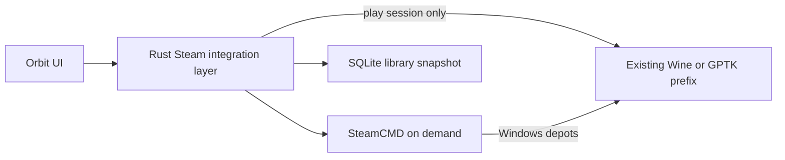

# Windows Steam on macOS

Status: first slice. macOS Apple Silicon stays the first target. Epic, GOG, and streaming stay deferred.

Sign-in, the owned-library snapshot, one Windows download at a time, and play through the existing compatibility runtime are implemented. A silent Steam client inside the Wine prefix is not started: play launches the installed Windows executable for that session and then the compatibility runtime owns the process. Steamworks titles can still fail until that in-prefix client exists.

Sign-in is one button in **Settings → Steam**. It opens an Orbit dialog with two methods: a QR code, and the Steam account form. A spinner stays up until the QR code is ready. Orbit does not open a Wine Steam window for login, because that window sits behind fullscreen Orbit and does not paint. The password is RSA-encrypted and sent only to Steam. The Library lists games that are not installed. Open a game, download it, then play it with the compatibility layer. SteamCMD, Valve's headless client, runs only during a download and is not left resident. Library screens read the SQLite snapshot.

## What already ships

Installed Mac Steam libraries are still scanned from local VDF files. Play still uses `steam://rungameid/{appId}`. `install_steam_game` still opens the Mac Steam app, and only when the store lists a Mac build. GameHub is not a provider; Steam library folders may be added in Settings. A manually imported Windows `.exe` still launches through the Wine or GPTK runtime in [RUNTIMES.md](RUNTIMES.md).

## Integration layer

Orbit remains the library UI. A Rust service owns the SteamCMD process, its working directory, and the SQLite snapshot. The frontend only invokes typed commands and never sees a password, guard code, or session file.

- **Sign-in** is an Orbit dialog. QR uses `IAuthenticationService/BeginAuthSessionViaQR`. Account sign-in uses Steam's RSA password key and `BeginAuthSessionViaCredentials`, with an optional Steam Guard code. The password is never stored. The frontend receives signed-in state, the account name, and an error state.
- **Library** asks that client for owned games with `include_appinfo`, caches app IDs, titles, and store copy in SQLite, and refreshes only when asked. Square SteamGridDB grids (1024×1024 / 512×512) fill the Steam tiles when a local key is saved; Steam CDN art is the fallback. Missing titles and longer store descriptions come from public store appdetails (`about_the_game`, HTML stripped) for every stale or incomplete title, installed and favorites first, batches of four, with a 7-day freshness window. A loading overlay stays up while that catalog hydrates. The Library search box covers the full owned catalog (capped at 2,000). The access token is used once and is never stored. The Mac-native scan and `steam://` launch stay as they are. Additional Steam library folders count as installed and can play through the same Wine path.
- **Download** sets the client platform to Windows, installs into a per-game prefix, and reports progress through the existing `steam:<appId>` tracker in `apps/desktop/src/lib/downloadProgress.ts`. One download at a time. The user follows that work from the shell, not from a resident Steam window.
- **Play** launches the downloaded Windows executable through the compatibility runtime for that session. It does not leave SteamCMD or the Steam window running. Games that require a silent in-prefix Steam client are still outstanding.

Sign-in is two HTTP calls, not a resident Steam window. Leftover Wine login processes are still stopped when Orbit quits. SteamCMD exists only during a download. Library screens read SQLite. Catalog hydrate fetches store copy and SteamGridDB square grids for every stale title, four requests in flight. The sidebar lists matching owned games (80 until the filter box is used). Status is one settings read. A library refresh reads one local Steam file, capped at 8 MiB, or returns the saved snapshot when that file is absent.

Rejected for this roadmap: embedding GameHub, leaving the full Steam GUI running after login, storing the Steam password, and copying Heroic or Legendary source. Epic, GOG, and streaming stay deferred.

## Shell

The macOS shell header (`MacosShell.tsx`) keeps Add games in the right-hand utilities group. **Downloads** sits beside that button and opens a right-hand Liquid Glass sidebar through `DrawerProvider`. The sidebar is the connection form, the in-progress transfers, and the network facts for the active transfer: whether Orbit's Steam client is running, and the current rate. It is not a packet capture. The sidebar card has no password field. The sign-in dialog can show one when Account is selected. Controller focus reaches the toolbar control and the sidebar, and the sidebar closes cleanly.

## Performance

Each phase is profiled on Apple Silicon before it is done. Measure Orbit and the Steam child for CPU and resident memory while idle, during a library refresh, during a download, and during play. After sign-in, refresh, and download, the Steam process is gone and Orbit returns to its idle baseline. Progress events stay throttled the way compatibility downloads already are. Library screens keep reading SQLite. A phase that leaves a heavy client running is not done. Record the sample with the phase notes.

## Phases

### 1. Authentication layer

Implemented. An Orbit connection form opens Valve's Steam login window when no account is saved. Orbit does not collect the password. The account name is stored in SQLite. Sign-out deletes only `steam-windows` under Orbit's data directory and the saved snapshot. If Orbit opened Steam, it quits Steam when sign-in finishes.

### 2. Owned library

Implemented. Depends on phase 1. Sign-in stores the owned catalog (app ID + Steam title) from `GetOwnedGames`. Refresh merges local `apptickets` IDs, capped at 2,000, without wiping saved titles. Ticket values are not kept. Library tiles use square SteamGridDB grids when a local key is saved. Details show the longer store description. A loading overlay covers the Steam grid while the catalog hydrates. Search covers the full owned list. The sidebar shows 80 titles until the filter box is used.

### 3. Download

Implemented. Depends on phase 2. One Windows depot install runs at a time into Orbit's `steam-windows/games/<app id>` directory. The first download fetches Valve's official SteamCMD archive. Progress uses the `steam:<appId>` task. Cancelling stops that process.

### 4. Run

Partly implemented. Depends on phase 3 and the current Wine or GPTK launch path. Play saves a Windows library entry and launches the installed executable through the compatibility runtime for that session. It does not keep a Steam client running. A silent Steam client inside the prefix is still required for games that refuse to start without Steamworks.

## Non-goals

- An Orbit account, cloud Steam login, or cloud sync.
- Reimplementing the Steam protocol.
- Bypassing Steam DRM.
- Reading GameHub credentials or driving GameHub's private commands.
- Redistributing SteamCMD. The machine uses Valve's official client.
- Changing Mac-native Steam scan, `steam://` launch, or the Mac-build install handoff.

Additional existing libraries can be configured in Settings → Library.
Accept a `steamapps/common` folder, its `steamapps` parent, or the library root.
Persist normalized folders in `additionalLibraryPaths` and merge manifest-based
Windows installs for owned-library installation status and Play. This preference
does not relocate downloads or move game files.

Executable discovery checks root files before nested assets within its
400-entry/four-level budget. This avoids missing GoW.exe behind large God of War
crash-data folders. Import scans run filesystem discovery off the async command
thread.

For Steam-linked Windows games, metadata/artwork matching uses the manifest AppID
rather than title search. On import/rescan, legacy automatic square icons are
replaced with verified 512×512 or 1024×1024 SteamGridDB grids resolved through that
AppID. A dedicated cache filename records this identity match. When unavailable,
the exact game's official Steam library capsule is used as the fallback.
