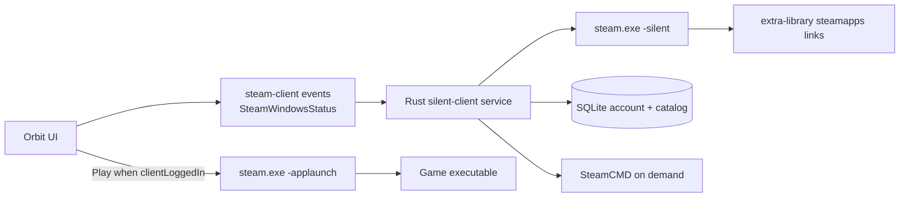
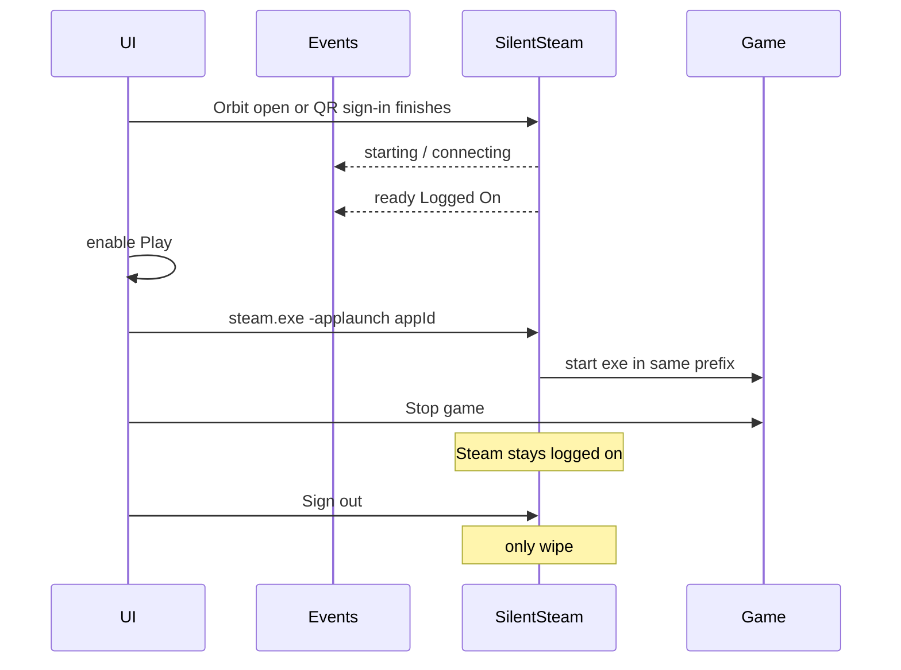

# Windows Steam on macOS

Status: first slice. macOS Apple Silicon stays the first target. Epic, GOG, and streaming stay deferred.

Sign-in, the owned-library snapshot, one Windows download at a time, and play through the existing compatibility runtime are implemented. Play uses a silent official Steam client in the signed-in `steam-windows` prefix so Steamworks titles can authenticate, then starts the title with `steam.exe -applaunch` in that same prefix. The Steam window is not left in the foreground; stopping the game leaves that silent client running.

Sign-in is one button in **Settings → Steam**. It opens official Windows Steam in Orbit's Wine prefix once and hosts that 840×520 login window over an Orbit dialog. The QR code (and the account form) are Steam's own, so the Windows client writes `loginusers.vdf` in the same prefix Orbit later launches. GPU drawing is disabled so the window paints under Wine. Orbit never collects the password. After Steam saves the login, Orbit records the account name, refreshes the owned catalog, hides that window, and leaves the logged-on client running for Play. The Library lists games that are not installed. Open a game, download it, then play it with the compatibility layer. SteamCMD, Valve's headless client, runs only during a download and is not left resident. Library screens read the SQLite snapshot.

## What already ships

Installed Mac Steam libraries are still scanned from local VDF files. Play still uses `steam://rungameid/{appId}`. `install_steam_game` still opens the Mac Steam app, and only when the store lists a Mac build. GameHub is not a provider; Steam library folders may be added in Settings. A manually imported Windows `.exe` still launches through the Wine or GPTK runtime in [RUNTIMES.md](RUNTIMES.md).

## Integration layer

Orbit remains the library UI. A Rust silent-client service owns the resident `steam.exe`, extra-library links, and `steam-client` events. SteamCMD runs only for a download. SQLite holds the account name and catalog; it is not the logon proof. The frontend only invokes typed commands and never sees a password, guard code, or session file.

Ready vs Play: the UI shows **Waiting for Steam…** and disables Play until `clientLoggedIn`. Rust still refuses `-applaunch` unless the latest `connection_log.txt` state is `[Logged On]` with a nonzero SteamID. `[Logged Off] [U:1:280673132]` is not ready.

- **Sign-in** launches official `steam.exe` once in Orbit's `steam-windows` prefix, with Steam's browser forced onto the CPU so the QR code is visible under Wine. Exclusive macOS fullscreen is dropped for that dialog so the Steam window can sit on the same space as Orbit, then restored when sign-in ends. Orbit places the 840×520 window on the sign-in dialog and polls until Steam writes `config/loginusers.vdf`. After a successful login Orbit hides that window with `steam.exe -silent` and leaves the logged-on client running. Wine Steam does not write `ConnectCache` / `ssfn*` (GameHub prefixes do not either); Play needs that resident client. Sign-out is what stops it. The account name is stored in SQLite. The password is never stored. The frontend receives signed-in state, whether Windows Steam is currently logged on (not merely that `loginusers.vdf` exists), the account name, and an error state. Sign in stays available so Play can attach to a live client without Sign out. A library snapshot without `loginusers.vdf` still shows Sign in so both clients can match.
- **Library** asks that client for owned games with `include_appinfo`, caches app IDs, titles, and store copy in SQLite, and refreshes only when asked. If the web snapshot is empty or slow, Orbit keeps IDs from the prefix `localconfig.vdf` `apptickets` block (ticket blobs are discarded). Square SteamGridDB grids (1024×1024 / 512×512) fill the Steam tiles when a local key is saved; Steam CDN art is the fallback. Missing titles and longer store descriptions come from public store appdetails (`about_the_game`, HTML stripped) for every stale or incomplete title, installed and favorites first, batches of four, with a 7-day freshness window. Each app's Steam type comes from one batched `IStoreBrowseService/GetItems` call on the Web API host (it stays reachable when the store's per-app `appdetails` endpoint rate-limits an address). Only `game`, `demo`, `mod` and `beta` titles appear in the Library, Home and owned-game lists, so software such as Driver Booster, tools, soundtracks, videos and DLC stay out. Apps the store has no item for (Steam's client, SDKs, Screenshots, delisted games) are shown only with play history or a local install. Unclassified entries stay visible until the lookup succeeds; a failed lookup is retried on the next hydrate. Extra-library installs (GameHub folders) that are not in GetOwnedGames still get a catalog row so hydrate can replace importer stubs. A loading overlay stays up while that catalog hydrates. The Library search box covers the full owned catalog (capped at 2,000). Installed / All games lists owned titles that are on disk (including additional library folders such as GameHub) versus owned titles that are not. The access token is used once and is never stored. The Mac-native scan and `steam://` launch stay as they are. Additional Steam library folders count as installed and can play through the same Wine path.
- **Download** sets the client platform to Windows, installs into a per-game prefix, and reports progress through the existing `steam:<appId>` tracker in `apps/desktop/src/lib/downloadProgress.ts`. One download at a time. The user follows that work from the shell, not from a resident Steam window.
- **Play** uses the logged-on silent `steam.exe` in the signed-in prefix, writes `steam.cfg` (`BootStrapperInhibitAll = Enable`) so the updater window does not block launch, links extra library folders (GameHub) into that client's `steamapps` without stopping a logged-on client, waits until that client is logged on and idle, then starts the title with `steam.exe -applaunch {appId}` in the same prefix. Orbit tracks the game process, not a second Steam. A client that is still signing in is left running (keep-alive); Play stays disabled until `clientLoggedIn`. GPTK (D3DMetal) is the Automatic graphics choice when installed, then DXMT, then DXVK+MoltenVK. Explicit DXMT or DXVK selections still win. SteamCMD is not left running. Stopping the game stops the game process and leaves the silent Steam client running. GameHub's packed SteamAgent and tokens are never copied into Orbit's prefix; Orbit's own environment uses the official client only.
- **Play engine** (`steam-windows-settings-v1` → `playEngine`, Settings → Steam): `auto` (default) plays a Steam title inside its GameHub container when a local GameHub engine manages it, and otherwise uses Orbit's silent official client; `orbit` always uses Orbit's own environment; `gamehub` requires the container and fails with a reason instead of falling back. The Play button checks the GameHub route before Orbit's own install lookup, so a title that exists only in a GameHub container gets its library record (title and art from GameHub's binding) instead of failing with "Download the game before playing". Under `auto`, a GameHub-managed title whose container is broken fails with GameHub's reason rather than silently switching to Orbit's client. Launch progress events carry the game title so the overlay names the game even before a library record exists. The GameHub route is read-only against GameHub's state: Orbit parses the engine registries, reproduces GameHub's verified launch recipe (its Wine build, the container overlay through `libsandboxfs.dylib` + the container's layer manifest, the container's graphics-stack environment, and the in-container `steam.exe` with `--offline --applaunch`), and never starts GameHub.app, its host RPC service, or its monitor. Orbit's stored Steam account name supplies `--username`; only when Orbit has none does Orbit read the plain `account_name` field from GameHub's account registry — token fields are not part of the parsed shape and are never stored, logged, or forwarded. A container with a live process is reported busy instead of launched. Stopping a container launch terminates that container's processes (`wineserver -k`), matching GameHub's own stop semantics; Orbit never writes to GameHub's registries.

Sign-in is Steam's own client window, not a separate HTTP QR. A successful sign-in leaves the silent client running; cancel and Sign out stop it. SteamCMD exists only during a download. Library screens read SQLite. Catalog hydrate fetches store copy and SteamGridDB square grids for every stale title, four requests in flight. The sidebar lists matching owned games (80 until the filter box is used). Status is one settings read. A library refresh reads one local Steam file, capped at 8 MiB, or returns the saved snapshot when that file is absent.

Rejected for this roadmap: embedding GameHub, leaving the full Steam GUI running after login, storing the Steam password, and copying Heroic or Legendary source. Epic, GOG, and streaming stay deferred.

## Shell

The macOS shell header (`MacosShell.tsx`) keeps Add games in the right-hand utilities group. **Downloads** sits beside that button and opens a right-hand Liquid Glass sidebar through `DrawerProvider`. The sidebar is the connection form, the in-progress transfers, and the network facts for the active transfer: whether Orbit's Steam client is running, and the current rate. It is not a packet capture. The sidebar card has no password field. Steam's hosted window can show one. Controller focus reaches the toolbar control and the sidebar, and the sidebar closes cleanly.

## Performance

Each phase is profiled on Apple Silicon before it is done. Measure Orbit and the Steam child for CPU and resident memory while idle, during a library refresh, during a download, and during play. After sign-in, a silent Steam client stays in the prefix for Steamworks; the GUI is not left in the foreground. Progress events stay throttled the way compatibility downloads already are. Library screens keep reading SQLite. Record the sample with the phase notes.

## Phases

### 1. Authentication layer

Implemented. Sign-in opens Valve's Windows Steam login window (QR and account) in the managed Wine prefix when no account is saved. Orbit does not collect the password. The account name is stored in SQLite after Steam writes the local login. Sign-in never deletes a prefix that already has `steam.exe` or `loginusers.vdf`; Install Steam for Windows is a no-op when Steam's browser helper is present. Otherwise it runs Valve's setup if needed, starts `steam.exe` so the client can finish downloading, and waits until `steamwebhelper.exe` exists under `bin/cef/cef.win64`, `cef.win7x64`, or `cef.win7` (Wine often ships the Win7 helper). Progress and errors use the `steam:setup` tracker, including package-download bytes while the client update is still running. A bootstrapper-only `steam.exe` is not treated as ready to sign in. Sign-out is the only action that deletes `steam-windows` and the saved snapshot. If Orbit opened Steam, it hides the login window and leaves the logged-on silent client running so Play can talk to Steamworks. Sign-out stops that client and deletes `steam-windows`.

### 2. Owned library

Implemented. Depends on phase 1. Sign-in stores the owned catalog (app ID + Steam title + playtime) from `GetOwnedGames` when the web session is ready, and always merges local `apptickets` IDs, capped at 2,000, without wiping saved titles or playtime. An empty GetOwnedGames response does not erase local tickets. Local `localconfig.vdf` Playtime fills gaps when the Mac or Wine Steam client has minutes and the snapshot does not. Ticket values are not kept. Library tiles use square SteamGridDB grids when a local key is saved. Details show the longer store description. A loading overlay covers the Steam grid while the catalog hydrates. Search covers the full owned list. The sidebar shows 80 titles until the filter box is used. Library Installed shows disk copies (Orbit downloads and additional library folders); All games includes owned titles that are not installed.

### 3. Download

Implemented. Depends on phase 2. One Windows depot install runs at a time into Orbit's `steam-windows/games/<app id>` directory. The first download fetches Valve's official SteamCMD archive. Progress uses the `steam:<appId>` task. Cancelling stops that process.

### 4. Run

Implemented. Depends on phase 3 and the current Wine or GPTK launch path. Play saves a Windows library entry, keeps a silent official Steam client in the signed-in prefix while Orbit is open (`steam-client` phases: `stopped` | `starting` | `connecting` | `ready` | `failed`), and starts the installed title with `steam.exe -applaunch`. Ready means that prefix is running `steam.exe`, the bootstrapper is idle, and the **latest** `connection_log.txt` state is `[Logged On]` with a nonzero SteamID. `[Logged Off] [U:1:id]` is not ready. A `steam.exe` process that is still verifying or updating is not ready; Play writes `steam.cfg` (`BootStrapperInhibitAll = Enable`) and `-noverifyfiles` so the updater window does not block launch, and it waits up to three minutes for logon without stopping a client that is still connecting. Home and details disable Play until `clientLoggedIn` (**Waiting for Steam…**). The Play action opens a centered landscape banner with the game hero, logo, and a single caption for the current startup stage (`resolve` → `runtime` → `steam` → `prefix` → `graphics` → `spawn` → `running`). If startup fails, the overlay keeps the error on that banner. Stopping the game stops the game process and leaves the silent Steam client running. Sign-out stops Steam. `wineserver -k` exiting 1 when the prefix is already idle is not a play failure; Orbit waits for `-w` to confirm shutdown. Native Mac Steam can already own UDP 27036; Wine Steam still logs on, and that bind warning is not treated as a sign-in failure.

## Non-goals

- An Orbit account, cloud Steam login, or cloud sync.
- Reimplementing the Steam protocol.
- Bypassing Steam DRM.
- Reading GameHub credentials or driving GameHub's private commands. The GameHub play engine reads only public engine registries and the plain account name; tokens stay untouched, and GameHub.app, its RPC service, and its monitor are never started.
- Redistributing SteamCMD. The machine uses Valve's official client.
- Changing Mac-native Steam scan, `steam://` launch, or the Mac-build install handoff.

Additional existing libraries can be configured in Settings → Library.
Accept a `steamapps/common` folder, its `steamapps` parent, or the library root.
Persist normalized folders in `additionalLibraryPaths` and merge manifest-based
Windows installs for owned-library installation status and Play. This preference
does not relocate downloads or move game files. Play also links those installs
into the managed Wine Steam `steamapps` folder and registers the library root as
a Wine drive (`S:` and up) in `libraryfolders.vdf`, so Steamworks sees GameHub
copies such as God of War as installed. Existing files in the prefix are not
replaced. A logged-on silent client is not restarted just to write
`libraryfolders.vdf`; that file is updated the next time Steam is stopped.

Executable discovery checks root files before nested assets within its
400-entry/four-level budget. This avoids missing GoW.exe behind large God of War
crash-data folders. Import scans run filesystem discovery off the async command
thread.

For Steam-linked Windows games, metadata/artwork matching uses the manifest AppID
rather than title search. On import/rescan, legacy automatic square icons are
replaced with verified 512×512 or 1024×1024 SteamGridDB grids resolved through that
AppID. A dedicated cache filename records this identity match. When unavailable,
the exact game's official Steam library capsule is used as the fallback.

### Wine browser and modal hosting

Orbit bundles its own small Windows CEF launcher (`helpers/steam-browser/`, embedded from `assets/steam-browser-helper.exe`). It preserves Valve's original helper as `steamwebhelper-orbit-original.exe`, forwards arguments literally, adds `--disable-gpu --single-process`, and returns the original exit code. The source and deterministic build command are shipped beside it. Run `bash apps/desktop/src-tauri/helpers/steam-browser/build.sh` from the repository root to rebuild (MinGW-w64 and clang required for rebuilding only). Steam is started with `-noverifyfiles` so its startup check does not immediately restore the original helper; actual client updates are preserved and wrapped again on the next sign-in. No Steam binary is redistributed.

The launcher recovers only its own browser windows created outside the visible screen during the first two minutes. Orbit then positions the managed browser over the modal host, follows Orbit window movement, and hides that browser when another app becomes active. This is managed native window hosting, not an NSView embedded across processes. Placement matches the complete installed helper path and its PID, never arbitrary Wine windows or native Steam. Accessibility/Automation denial is reported in the dialog. Polling is one positioning request at a time; it stops on errors or after 30 seconds without a window. The dialog shows instructions only after placement succeeds.

Per-frame positioning runs off the Tauri command thread. Process discovery has a two-second limit, a 1 MiB output cap and at most eight matching helper processes. Browser replacement reads at most 32 MiB and rejects symlink targets. Cancel dismisses the modal and reports any native shutdown failure outside it.

### Already-stopped server handling

Wine's `wineserver -k` exits with code 1 when no server is running. This is a normal
startup and cancellation condition, not a sign-in failure. Orbit sends the kill
request and then requires a successful `wineserver -w`, with a three-second bound
on each process, to certify that the managed prefix is stopped. Failed monitoring
or timeout still reports an error. Cancel dismisses the modal even on cleanup
failure and shows that message through Orbit's notification surface.
